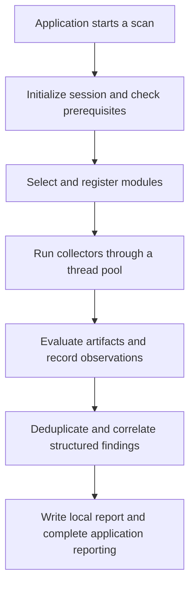

# Hypervision

Hypervision is a modular Windows scanner for examining evidence of suspicious software activity, process injection, and system changes. It brings together file-system artifacts, Windows event logs, memory inspection, and boot measurements to support manual investigation of a PC.

The project contains detection modules and shared reporting components. It is not currently a complete, ready-to-run desktop application; see [Build status](#build-status).

## What it examines

| Area | Evidence examined | Main directories |
| --- | --- | --- |
| File activity | USN Journal changes, file creation/deletion, and execution-related artifacts | [usnjournal/](usnjournal/), [usn_modified/](usn_modified/), [executed_files_detection/](executed_files_detection/) |
| Execution history | Prefetch records and related integrity checks | [prefetch_parser/](prefetch_parser/), [prefetch_integrity/](prefetch_integrity/) |
| Processes and memory | Executable regions, PE structure, loaded modules, hooks, threads, and Java runtime context | [atlas_trace/](atlas_trace/), [pe_injection_detection/](pe_injection_detection/), [client_checks/](client_checks/) |
| Windows logs | PowerShell sessions, cleared event logs, and Defender records | [powershell_detections/](powershell_detections/), [eventlog_cleared_detection/](eventlog_cleared_detection/), [windows_defender/](windows_defender/) |
| Services and drivers | Service state, recent driver installation, signature context, and Code Integrity events | [services/](services/), [test_signing/](test_signing/) |
| Boot environment | UEFI variables, Secure Boot state, TPM measurements, and EFI image artifacts | [efi_detections/](efi_detections/) |
| Files and crash dumps | YARA patterns, dump metadata, hashes, and available process identity | [client_checks/yara_scanner/](client_checks/yara_scanner/), [crash_dump_checks/](crash_dump_checks/) |
| Application artifacts | Application-specific strings, saved-file artifacts, shortcuts, and browser records | [strings/](strings/), [customstrings/](customstrings/), [saved_files/](saved_files/), [browser_detections/](browser_detections/) |

A module's presence in the repository does not mean it runs in every scan. Selection depends on compile-time game profiles, policy, permissions, and available data.

## How a scan works



### 1. Initialization and module selection

[detection_root.cpp](detection_root.cpp) coordinates the scan. It initializes application services, checks prerequisites, and registers the modules selected by build flags such as `DETECT_MINECRAFT` or `DETECT_FIVEM`. Disabled module IDs are filtered before execution.

The current application flow also checks server availability and can stop before scanning, for example when its test-signing check is triggered. Local report support does not make the complete scan flow independent of the application backend.

### 2. Collection and evaluation

A thread pool runs the selected modules. Each module examines a particular source, such as an event channel, a journal, or a process. YARA matches file patterns; native Windows APIs provide additional context such as timestamps, service state, and signature results.

Shared collectors apply resource budgets where implemented. Access denial, missing logs, unsupported records, or an exhausted budget can reduce coverage. An empty result is not proof that every source was successfully inspected.

### 3. Structured findings and correlation

The shared reporting layer in [echo_integration/](echo_integration/) records observations with separate confidence and severity values. It deduplicates findings with the same rule ID, entity, and timestamp.

Correlation requires matching normalized entities, available timestamps within 300 seconds, and more than one source. Several strings from the same source do not count as independent corroboration. Correlation can increase confidence without automatically increasing severity.

For example, a PowerShell session-ending event is ordinary telemetry. A graphics DLL name or an overlay symbol can also belong to legitimate software. These observations need context rather than an automatic cheating verdict.

Not every existing detection module uses this structured model. Some modules retain their own rules, severity decisions, and logger output.

## Reports and generated files

The structured report is written to:

```text
%LOCALAPPDATA%\Hypervision\reports\latest.json
```

A successful write replaces the previous report. Its main sections are:

| Section | Contents |
| --- | --- |
| `findings` | Rule IDs, categories, artifact types, confidence, severity, timestamps, evidence summaries, sources, and known false positives |
| `modules` | Registered module IDs and available metadata; unaudited values may remain `unknown`, `unmeasured`, or `legacy` |
| `metrics` | Module duration and whether an exception escaped the module |

In this report, internal entity keys are replaced with numeric IDs and source paths are represented as `[local-only]`. A timestamp of `0` means unavailable. The shared report writer does not upload this JSON; other application components still use the logger, heartbeat, rule-delivery, and scan APIs. These protections do not describe all data handled by every module.

The former repository `output/` directory only held a duplicate source ZIP. It was not a runtime dependency and has been removed. Use GitHub's **Code → Download ZIP** or clone the repository to obtain the source. Native test binaries are generated separately in `tests/build/` and ignored by Git.

## Configuration

Shared collector policy is defined in [echo_integration/core.h](echo_integration/core.h). Configure it before starting a scan; do not modify it while workers are running.

```cpp
// Disable the shared shortcut collector.
echo_integration::policy.disabled.insert("lnk");

// Disable an entire registered task, including its existing checks.
echo_integration::policy.disabled.insert("c_saved.start_saved_files");

// Set the shared USN/event lookback window to one hour.
echo_integration::policy.window_seconds = 3600;
```

Default shared limits include a 5,400-second lookback window, 2,048 findings, and budgets of 100,000 work units, 128 files, 32 MiB per file, and 15 seconds where those limits are applied. They are not universal limits for all modules. Existing YARA scanning has its own timeouts, and blocking Windows calls are not forcibly interrupted.

Setting `policy.enabled = false` disables the shared collectors/findings, not the entire scanner. Setting `echo_integration::cancelled = true` requests cooperative cancellation of shared loops; it does not terminate every existing module.

## Build status

The full application currently requires files and dependencies that are not in this repository:

- The application entry point and main solution/project configuration.
- `pch.h`, `utils/`, and `scan_api/`.
- The required third-party headers and libraries, including the YARA SDK.

There is no validated standalone Hypervision executable or complete application build command yet. The bundled SQLite project alone does not build the scanner.

The standalone component tests can be built independently with Windows, MSVC supporting C++17, and the Windows SDK. YARA fixtures require Python and `yara-python`.

## Running the tests

From the repository root, run the native fixtures:

```bat
tests\run-tests.cmd
```

The script initializes MSVC, compiles `tests/echo_tests.cpp`, and runs the resulting test executable. Adjust the Visual Studio path in [tests/run-tests.cmd](tests/run-tests.cmd) if your installation differs.

Run the YARA fixtures with:

```powershell
python -m pip install yara-python
python tests/test_yara.py
```

The fixtures cover shared parsing and evaluation behavior, including USN aggregation, UEFI/minidump boundaries, event context, deduplication, correlation, data minimization, and positive/negative YARA cases. They use synthetic input and do not launch a scan of personal files.

Passing these tests checks component behavior. It does not establish detection accuracy, false-positive rates, or full application stability across Windows versions. Those require clean-system baselines and authorized laboratory validation.
